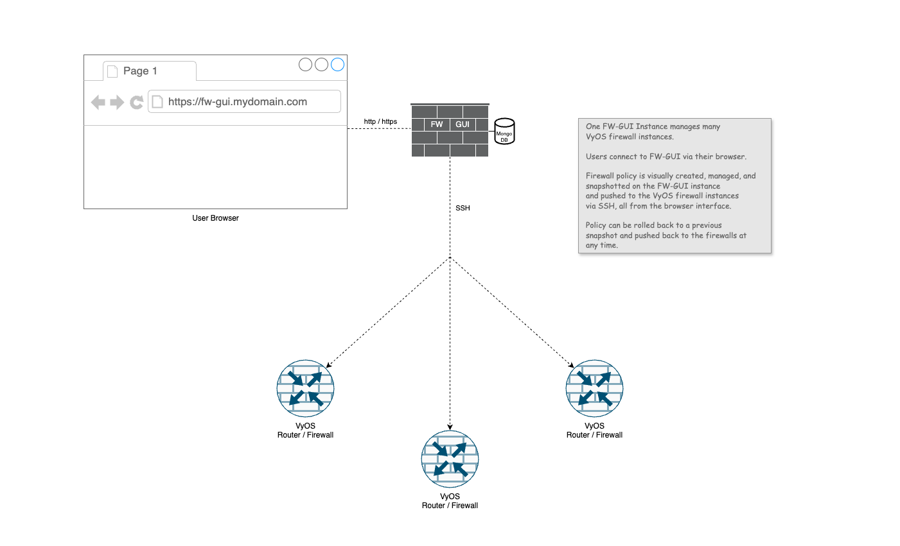
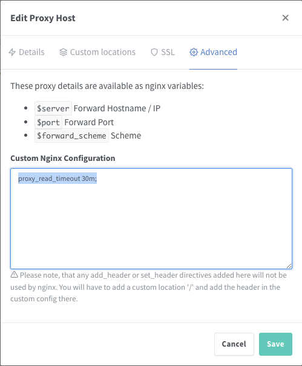
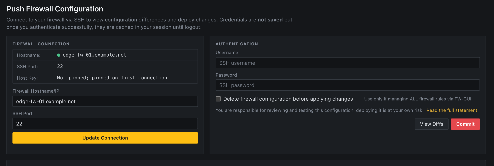
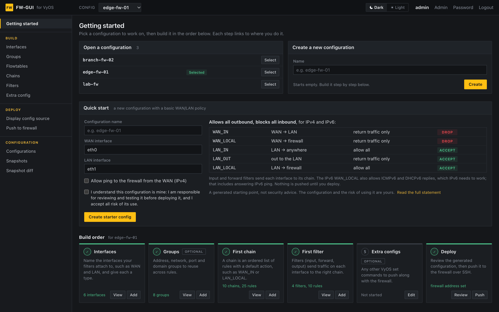
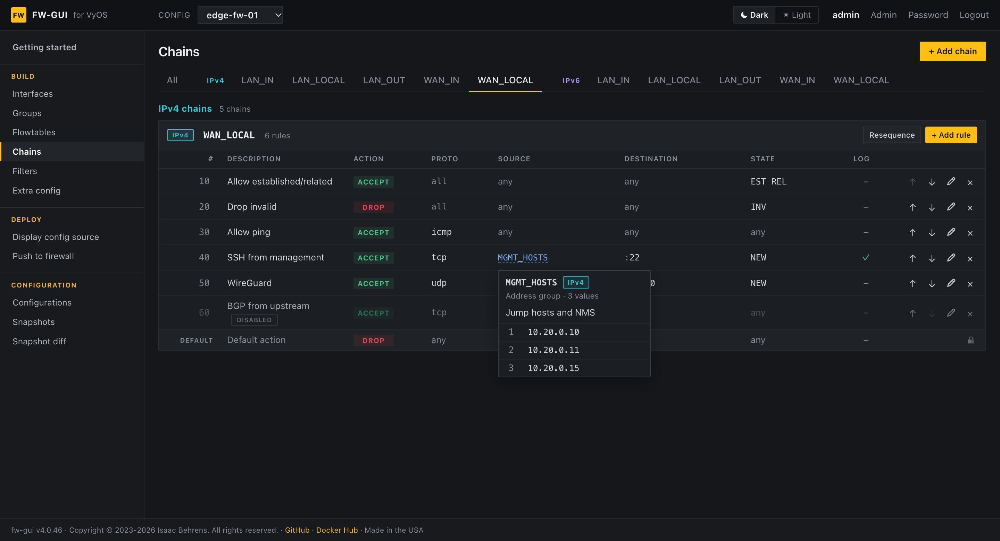
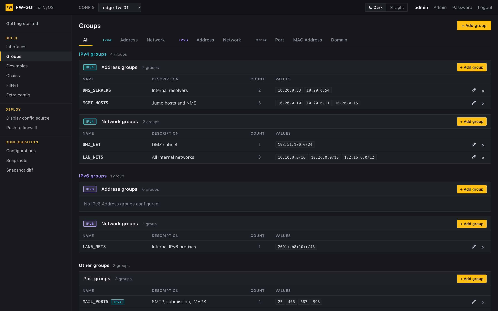
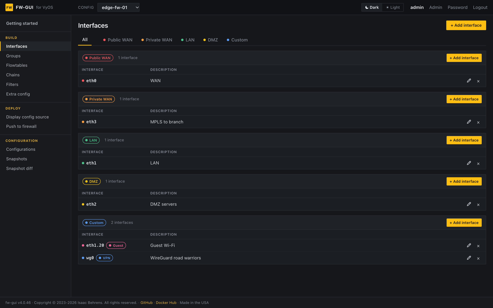
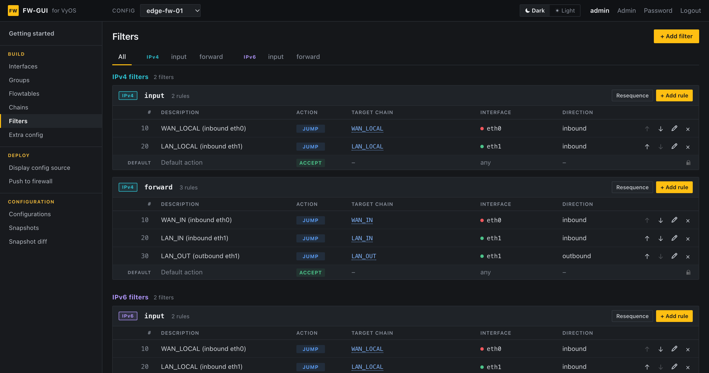
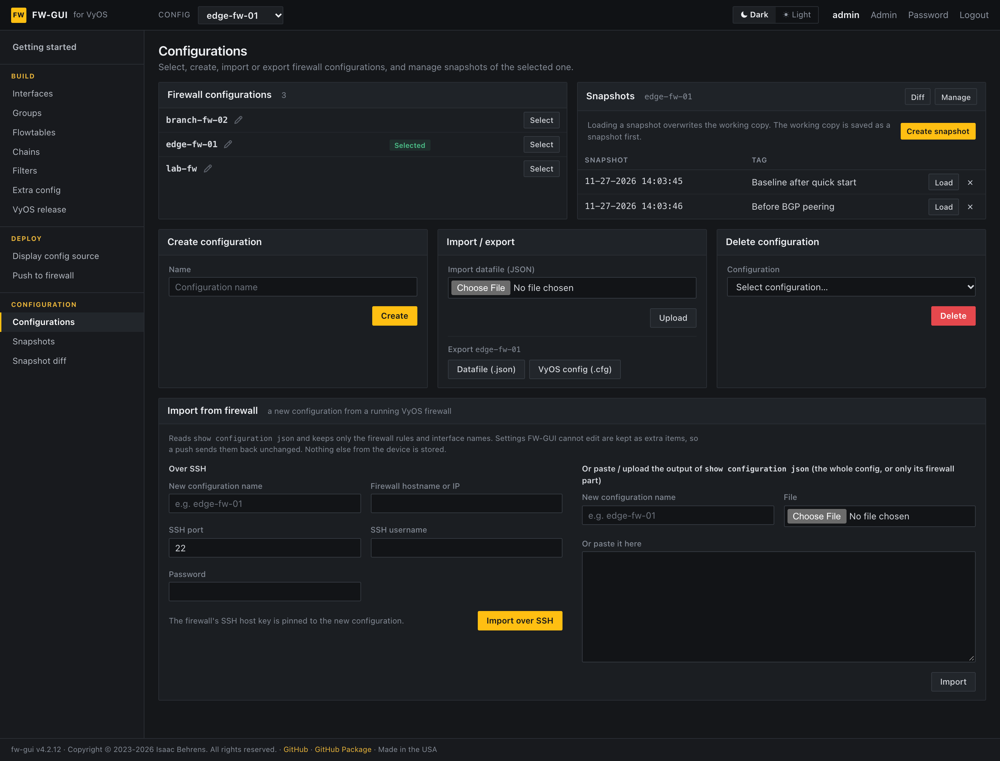

[](https://www.buymeacoffee.com/ibehren1)  
Tell me how you are using FW-GUI! [File a Usage Report](https://github.com/ibehren1/fw-gui/issues/new?assignees=ibehren1&labels=Usage+Information&projects=&template=report-usage-information.md&title=Report+Usage+Information)


# FW-GUI for use with VyOS

### Disclaimer
The FW-GUI project is not affiliated with VyOS in any way.  It is a wholly separate project to build a community tool that helps to visually build and manage firewall specific configurations for VyOS firewalls.  This project is not owned by VyOS.io, or Sentrium S.L., nor does it seek to appear to be an official project, product or partner of the aforementioned.

FW-GUI is developed and maintained by [@ibehren1](https://www.github.com/ibehren1).  
Copyright © 2023-2026 Isaac Behrens. All rights reserved.

## FW-GUI for Managing Firewall Rule Configurations on VyOS Firewalls

The web-based FW-GUI allows the user to visually:
- Get started quickly: a **Getting started** page shows the build order (interfaces, groups, chains, filters, extra configuration, deploy) and how far the selected configuration has got, and **Quick start** creates a ready-made WAN/LAN policy for IPv4 and IPv6 that allows all outbound and blocks all inbound
- Create and manage interfaces, colour-coded by type (Public WAN, Private WAN, LAN, DMZ, or a custom label and colour)
- Create and manage group objects (address, network, port, MAC and domain groups)
- Create and manage firewall chains and filters, shown as compact rule tables with each chain's or filter's default action as its last row
- See a group's type and values by hovering over it in a rule
- Create and manage flowtables
- Manage multiple firewall configurations: create, rename, import/export (JSON) and delete them on the **Configurations** page
- Import the configuration of a running VyOS firewall, over SSH or by pasting `show configuration json` output: groups, chains, filters, flowtables and interfaces become editable, anything FW-GUI cannot edit is kept as extra configuration so a push sends it back unchanged, and an import report shows whether a push would match the firewall exactly
- Create and compare (diff) snapshots of firewall configurations
- Tag snapshots with a note describing why they were taken, and load or delete them from the Manage Snapshots page
- Loading a snapshot automatically snapshots the working copy first (tagged "auto-snapshot before reloading snapshot"), so nothing is lost
- Push the created policy configurations to the firewall(s) via SSH connectivity from the web interface, with the firewall's SSH host key pinned on first use
- Download the generated VyOS configuration (`.cfg`)
- Work in a dark or light theme, chosen at first login and switchable from the top bar

(FW-GUI only manages configurations under 'set firewall' in the command line syntax.)



## Documentation

- [Data Architecture](docs/data-architecture.md) — how FW-GUI stores and moves data: MongoDB config/snapshot model, MongoDB-backed authentication (SQLite before 3.0.0), session store, filesystem layout, backups, and data flow (with diagrams).
- [SSH, Password, Key & Cookie Handling](docs/ssh-credential-handling.md) — how SSH connectivity, passwords, keys, and cookies are stored, used, and disposed of (with diagrams).
- [MongoDB Restore Procedure](docs/mongodb-restore-procedure.md) — how to restore a MongoDB dump into a running `mongodb` container (with diagram).
- [MongoDB Major-Version Upgrade](docs/mongodb-upgrade.md) — why `mongo:latest` can stop an existing install from starting, and how to upgrade one major at a time using the feature compatibility version (with diagram).

## VyOS Release Support

| VyOS Release   | FW-GUI Testing | FW-GUI Support (no SLA) |
|----------------|----------------------------|----------------|
| VyOS 1.3.x Equuleus | - Untested | - No support (do not open issues) |
| VyOS 1.4.x Sagitta | - Designed for 1.4 and heavily tested in 2024.<br> - No known issues but no longer tested due to VyOS closed release versions. | - Open [GitHub issues](https://github.com/ibehren1/fw-gui/issues/new/choose) for errors.<br> - Best effort support on old build from July 2024. |
| VyOS 1.5.x Circinus<br>(rolling release) | - Minimal testing but no known issues. | - Open [GitHub issues](https://github.com/ibehren1/fw-gui/issues/new/choose) for errors.<br> - Issues may be deprioritized due to unstable daily build status.
| **VyOS 1.5 Stream**<br>(latest release) | - Minimal testing but no known issues.<br>- Current target version for development and testing. | - Open [GitHub issues](https://github.com/ibehren1/fw-gui/issues/new/choose) for errors.<br>- Current quarterly stream release is where testing/fixes will be targeted.

| Status | | |
| - | - | - |
| Source Code |  | [https://github.com/ibehren1/fw-gui](https://github.com/ibehren1/fw-gui)  |
| GitHub Container Registry | | [https://github.com/ibehren1/fw-gui/pkgs/container/fw-gui](https://github.com/ibehren1/fw-gui/pkgs/container/fw-gui) |
| Docker Hub |  | [https://hub.docker.com/repository/docker/ibehren1/fw-gui/general](https://hub.docker.com/repository/docker/ibehren1/fw-gui/general)  |
| Working Demo |  | [https://fw-gui.com](https://fw-gui.com) |

### Rolling release features

Some VyOS features reach the rolling (daily) builds well before a stable release. To use them, open **VyOS release** in the sidebar for a configuration, turn on **Target a VyOS rolling release**, and choose the oldest rolling build you run. Each choice in the list names the features it enables. Configurations that leave rolling off target stable and generate exactly the same commands as before.

| Rolling build | Feature | What FW-GUI adds |
|---------------|---------|------------------|
| Aug 2026+ | Rule last-used tracking ([T8221](https://vyos.dev/T8221)) | A **Track last used** option on chain and filter rules, plus a switch on the VyOS release page that applies it to every rule. Generates `set firewall ... rule N last-used`, after which `show firewall ... detail` reports when each rule last matched. Run e.g. `show firewall ipv4 name WAN_LOCAL detail` or `show firewall ipv4 forward filter detail` from the push page to get a sortable **Last used** column. |

Rule settings for a rolling feature are kept if you switch back to stable or pick an earlier build. They are just not generated, because a stable release would reject them.

### Recommended Usage

Deploy via Docker on a server/VM that will be used to manage multiple VyOS Firewall instances.  Use [Nginx Proxy Manager](https://nginxproxymanager.com/) (also via Docker) on the same host to provide LetsEncrypt TLS encryption between client (web browser) and FW-GUI. Recommend adding `proxy_read_timeout 30m;` as a custom Nginx configuration.



See [Deployment](#deployment) section below for configuration commands.

### Known Issue

When deployed behind HAProxy (VyOS load-balancing reverse-proxy) timeouts can prevent diffs and commits for firewalls with large configurations.  Issue is not observed connecting directly to app when hosted in Docker or behind Nginx proxy.

Resolution: TBD

## Committing to the Firewall

Connections to the firewall are made using the [Napalm-VyOS library](https://github.com/napalm-automation-community/napalm-vyos) via SSH.  Napalm for VyOS only allows merging configurations (changes with existing) and does not allow for replacing configurations (new replacing existing).  As such, by default, if you remove an item from the config and push, it will not be removed from the firewall as the configs are merged.  To work around this, the View Diffs and Commit interface has the option to preface the firewall configuration with a 'delete firewall' command.  This causes the configuration to remove all firewall configuration and then add the specified configuration settings so that the net configuration is a replacement of the existing configuration.  You will __NOT__ want to use this feature unless you are managing __ALL__ firewall configurations via the GUI.



## Initial Login

There is no initial username and password.  After starting the application, use the "Register as a new user" link to create your username and password.  Once you have registered your user(s), you can disable user registration by updating the environment variable in Docker configuration to `DISABLE_REGISTRATION=True`. Doing this will remove the link to the registration page and stop any POSTS to the route /user_registration from being processed.  This can be reenabled anytime you need to setup users.

The first time you log in you are asked to choose a dark or light theme; it is saved to your account and can be changed at any time from the top bar.  You then land on the **Getting started** page: open or create a configuration, use **Quick start**, or import an existing firewall's configuration, and follow the build order from there.

Configurations generated by FW-GUI, including Quick start, are a starting point and not security advice.  You are responsible for reviewing and testing any configuration before deploying it, and deploying it is at your own risk (FW-GUI is provided as-is under the MIT License).

Admin Settings covers backups and MongoDB status.  There is no user management yet: accounts are created through registration.

## Backups

You can provide an Amazon S3 bucket name and user credentials as environment variables to enable offsite storage of backups in the S3 bucket.  Backups are created in the Admin Settings page.  Backups are always kept locally and uploaded if the S3 settings are provided.  __Only Amazon S3 is supported.__

Access to the backup files is not provided via the web interface as it contains configurations of all users.  Access to the backup is on the Docker host in the FW-GUI volume or via the S3 bucket (if configured).

### Automatic weekly backups

As of 3.0.0 FW-GUI can take the full backup on its own, once a week, without anyone clicking the button.  It is **off until you switch it on**, and everything about it is configured on the Admin Settings page:

| Setting | Default | Purpose |
|---------|---------|---------|
| Run a full backup automatically every week | off | Whether the schedule runs at all. |
| Day | Sundays | Day of the run. |
| Hour (UTC) | 03:00 | Hour of the run.  **UTC**, so it does not shift with daylight saving. |
| Backups to keep | 4 | How many archives and MongoDB dumps to keep.  Four *weekly* backups, so about a month.  `0` never deletes anything. |

**There are no environment variables for any of this.**  The settings are stored in MongoDB, so they survive a restart, a container replacement and a redeploy, and a change takes effect immediately without one.  The same page shows the current schedule, the last run and its result, and the next run.

**Scheduled runs delete old backups; manual ones never do.**  This is deliberate: before 3.0.0 nothing in FW-GUI removed a backup or a MongoDB dump, and because every archive re-includes every retained dump, the archives grew without bound.  After each scheduled run only the newest N archives and dumps are kept.  When you save the settings the page tells you exactly how many old files the next run will remove, so an install that has accumulated years of them is not surprised.  Set **Backups to keep** to `0` to schedule backups without ever deleting anything — but note that nothing then bounds the size of the data directory.

Nothing is ever deleted from S3.  Offsite copies exist to survive mistakes made on the host, so the app does not prune them — use an [S3 lifecycle rule](https://docs.aws.amazon.com/AmazonS3/latest/userguide/object-lifecycle-mgmt.html) on the `fw-gui/backups/` prefix if you want them expired.

A missed window is caught up once, not once per week missed: an instance that was switched off for a month takes one backup shortly after it starts again, then returns to its normal schedule.  Running more than one replica is safe — each claims the run atomically in MongoDB, so exactly one of them backs up.

There is still no automated restore.  Retrieving an archive, and restoring a MongoDB dump from it, remains a manual operation on the host or from S3 — see the [MongoDB Restore Procedure](docs/mongodb-restore-procedure.md).

### MongoDB upgrades

An existing MongoDB install can only move up **one major version at a time**, and only after its *feature compatibility version* (FCV) has been raised to match the version it runs.  The compose files pin `image: mongo:8` for that reason: with `mongo:latest` a pull can skip a major and leave MongoDB unable to start.  **Admin Settings → MongoDB** shows the server version and FCV, says whether the install is ready for the next major, and can raise the FCV (taking a full backup first).  The full procedure is in [MongoDB Major-Version Upgrade](docs/mongodb-upgrade.md).

## Telemetry

FW-GUI reports anonymous usage to `telemetry.fw-gui.com` so the developer can see how many installs exist, which versions are in use and how FW-GUI is deployed.  It is sent in the background and never affects the app if the server is unreachable.

- **Each install** is identified by a random UUID generated on first start (stored in MongoDB), not by anything about you.
- **At startup and once a day:** the FW-GUI version; how it is deployed (Docker, Kubernetes or from source), CPU architecture, Python and MongoDB versions; the number of accounts, configurations and rules **in ranges** (e.g. `2-5`), never exact; and yes/no flags for which features are in use (light theme, quick start, flowtables, interface types, scheduled and S3 backups, stored SSH keys, open registration, VyOS rolling release, configuration imported from a firewall).
- **At each login:** only the UUID and version.
- **For each View Diffs, Commit and operational command:** only the UUID, to count use.

**Never sent:** usernames or emails, configuration or rule contents, the names of chains, groups or interfaces, IP addresses or hostnames from your configurations, credentials or SSH keys.  Like any web request, the telemetry server sees the IP address the request comes from.  The full list is in [Data Architecture §10](docs/data-architecture.md#10-telemetry).

## Deployment

### Breaking Upgrade for version v1.4.0+

FW-GUI v1.4.0+ uses a separate MongoDB database to store configurations.  If you first deployed with a version lower than 1.4.0, you will need to update your deployment to connect to either an external MongoDB database or deploy a second container to host MongoDB.

See below for updated Docker Compose configuration settings.


### Recommended Deployment -- Docker Compose for combined FW-GUI, MongoDB and Nginx Proxy Manager

```diff
+ Lines highlighted in green are the additions for v1.4.0+ to add MongoDB.
```

```diff
services:
  fw-gui:
    image: ghcr.io/ibehren1/fw-gui:latest
    container_name: fw-gui
+    depends_on:
+     - mongodb
    environment:
      # Change this default to a unique random value before any non-local use.
      - APP_SECRET_KEY='This is the secret key.'
      - DISABLE_REGISTRATION=<True|False>
      - SESSION_TIMEOUT=<number-of-minutes> # Default 120 minutes
+     - MONGODB_URI=mongodb
      - BUCKET_NAME=<bucket-name>
      - AWS_ACCESS_KEY_ID=<access-key>
      - AWS_SECRET_ACCESS_KEY=<secret-access-key>
    ports:
      - 8080:8080/tcp
    restart: unless-stopped
    volumes:
      - fwgui-data:/opt/fw-gui/data
  nginx:
    restart: always
    image: 'jc21/nginx-proxy-manager:latest'
    ports:
      - '80:80'
      - '81:81'
      - '443:443'
    environment:
      DB_MYSQL_HOST: "db"
      DB_MYSQL_PORT: 3306
      DB_MYSQL_USER: "npm"
      DB_MYSQL_PASSWORD: "npm"
      DB_MYSQL_NAME: "npm"
    volumes:
      - nginx-data:/data
      - letsencrypt:/etc/letsencrypt
  db:
    restart: always
    image: 'jc21/mariadb-aria:latest'
    environment:
      MYSQL_ROOT_PASSWORD: 'npm'
      MYSQL_DATABASE: 'npm'
      MYSQL_USER: 'npm'
      MYSQL_PASSWORD: 'npm'
    volumes:
      - mysql-data:/var/lib/mysql
+ mongodb:
+   container_name: mongodb
+   image: mongo:8
+   restart: always
+   volumes:
+     - mongo-data:/data/db
+     - mongo-config:/data/configdb
volumes:
  fwgui-data:
  nginx-data:
  mysql-data:
  letsencrypt:
+ mongo-data:
+ mongo-config:
```

### Docker Run

No longer recommended with additional MongoDB container needed.

### Docker Compose Minimal (just FW-GUI and MongoDB no TLS)

```yaml
services:
  fw-gui:
    image: ghcr.io/ibehren1/fw-gui:latest
    container_name: fw-gui
    depends_on:
      - mongodb
    environment:
      # Change this default to a unique random value before any non-local use.
      - APP_SECRET_KEY='This is the secret key.'
      - DISABLE_REGISTRATION=False
      - SESSION_TIMEOUT=120
      - MONGODB_URI=mongodb
      - BUCKET_NAME=
      - AWS_ACCESS_KEY_ID=
      - AWS_SECRET_ACCESS_KEY=
    ports:
      - 8080:8080/tcp
    restart: unless-stopped
    volumes:
      - data:/opt/fw-gui/data
  mongodb:
    container_name: mongodb
    image: mongo:8
    restart: always
    volumes:
      - mongo-data:/data/db
      - mongo-config:/data/configdb
volumes:
  data:
  mongo-data:
  mongo-config:
```

### Kubernetes Install via Helm

```bash
git clone https://github.com/ibehren1/fw-gui.git
cd fw-gui
helm install fw-gui ./chart/fw-gui
```

### Running from source

FW-GUI requires **Python 3.14+** and a reachable MongoDB.  With [uv](https://docs.astral.sh/uv/):

```bash
uv sync
uv run python app.py
```

Settings are read from the environment or a `.env` file (`APP_SECRET_KEY`, `MONGODB_URI`, and the others shown in the Docker Compose examples).

## Interface Screenshots

**Getting started:** open or create a configuration, Quick start, and the build order with progress for the selected configuration.


**Chains:** one row per rule, the default action as the last row, and a group's values on hover.


**Groups:** grouped by IPv4, IPv6 and other types.


**Interfaces:** grouped and colour-coded by type.


**Filters:** input and forward filters jumping to chains per interface and direction.


**Configurations:** configurations, snapshots, and create, rename, import, export and delete.

