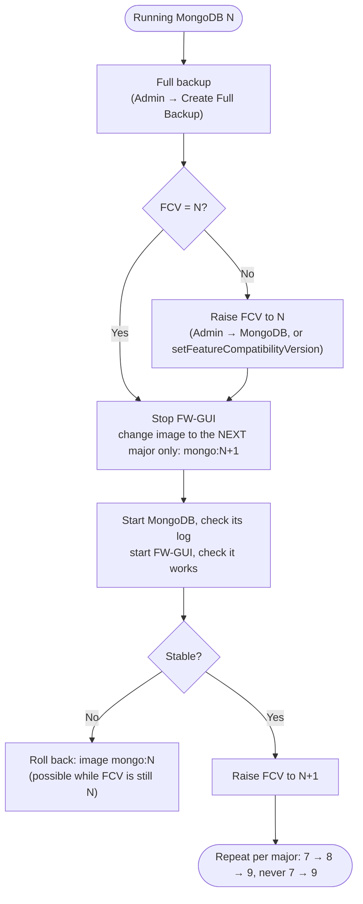

# MongoDB Major-Version Upgrade

How to move FW-GUI's MongoDB to a newer **major** version (for example 7 → 8)
without the database refusing to start.

## Why `mongo:latest` can break an existing install

A fresh install of any MongoDB version works. Existing data is different:

- MongoDB stores a **feature compatibility version (FCV)** with the data. It
  is the oldest version the data files must stay readable by.
- A new major version only starts on data whose FCV is the **previous**
  major. MongoDB 8 starts on FCV `7.0` data, but not on FCV `6.0`.
- Upgrading the binaries does **not** raise the FCV. That is deliberate, so
  that rolling back stays possible, but it means the FCV falls behind unless
  someone raises it.

With `image: mongo:latest`, a `docker compose pull` can skip a major (6 → 8),
or jump a major while the FCV still trails. `mongod` then exits with an
*invalid featureCompatibilityVersion* error, and FW-GUI cannot reach its
database.

**Admin Settings → MongoDB** shows the server version and FCV, and warns when
the FCV is behind the server (not ready for the next major).



## Procedure (one major at a time)

The commands assume the container is named `mongodb`, as in
`docker/docker-compose.*.yml`.

1. **Back up.** In FW-GUI: *Admin Settings → Create Full Backup*. It includes
   a `mongodump` (see [MongoDB Restore Procedure](mongodb-restore-procedure.md)).

2. **Check the server version and FCV.** On *Admin Settings → MongoDB*, or:

   ```bash
   docker exec -it mongodb mongosh --quiet --eval \
     'db.version(); db.adminCommand({getParameter: 1, featureCompatibilityVersion: 1})'
   ```

3. **Make the FCV equal the version you run now.** If it is behind, use
   *Raise feature compatibility version* on the Admin page (it takes a backup
   first by default), or run it yourself, for example on 7.x:

   ```bash
   docker exec -it mongodb mongosh --quiet --eval \
     'db.adminCommand({setFeatureCompatibilityVersion: "7.0", confirm: true})'
   ```

   (`confirm: true` is required from MongoDB 7.0 on; leave it out on 6.0 and
   older.)

4. **Move to the next major only.** Stop FW-GUI, change the `mongodb` image
   from `mongo:7` to `mongo:8` (not straight to the newest), then:

   ```bash
   docker compose up -d mongodb && docker compose logs -f mongodb
   ```

   Once MongoDB is up, start FW-GUI and check that configurations load and a
   snapshot can be created.

5. **Raise the FCV to the new major** once you are happy it is stable. Until
   then, going back to the previous image is still possible. After it, a
   rollback needs the backup from step 1.

6. **Repeat** steps 1–5 for each further major.

## Before you start

- Read the target version's release notes for upgrade prerequisites.
- Check the CPU: recent MongoDB needs AVX on x86-64 and ARMv8.2-A on ARM. A
  Raspberry Pi 4, for example, cannot run MongoDB 5.0 or later.
- Check that FW-GUI's pymongo version supports the target server version.

## Avoiding surprise upgrades

Pin a major version you have tested, for example `image: mongo:8`, instead
of `mongo:latest`. Then a pull only brings fixes within that major, and a
major upgrade happens only when you change the tag and follow this procedure.
