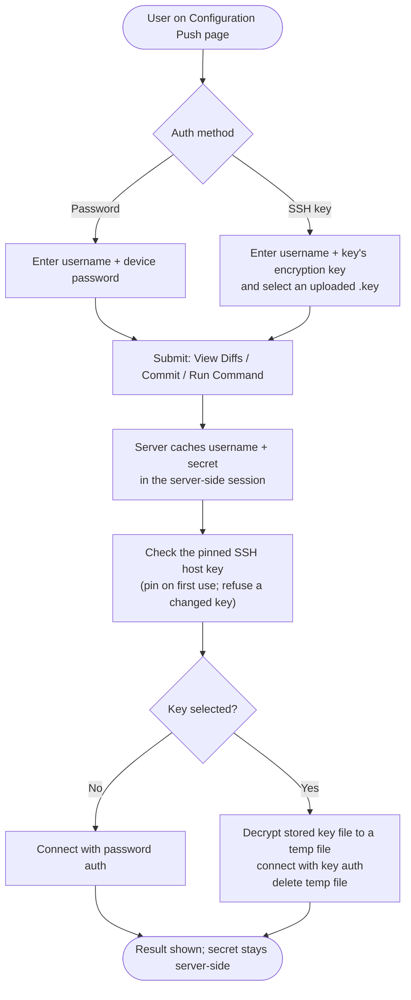
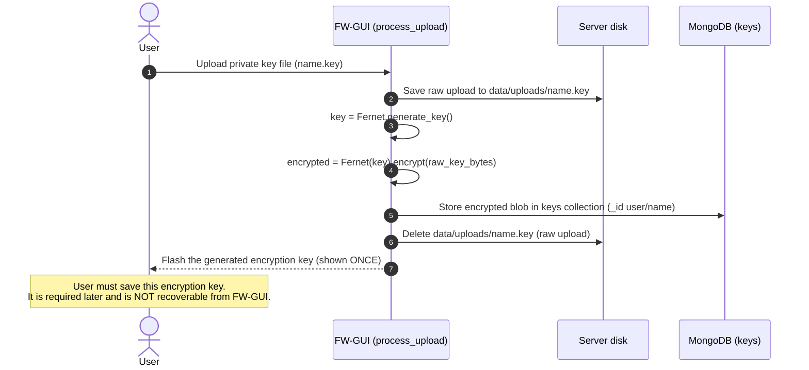
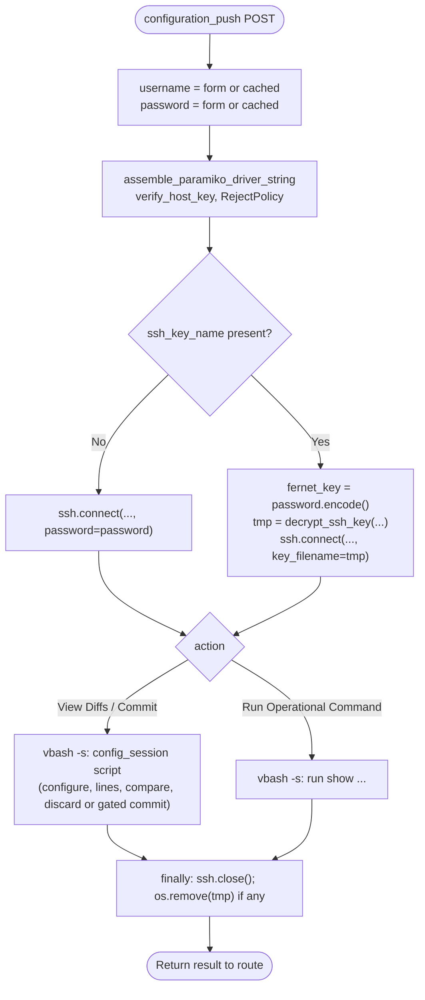
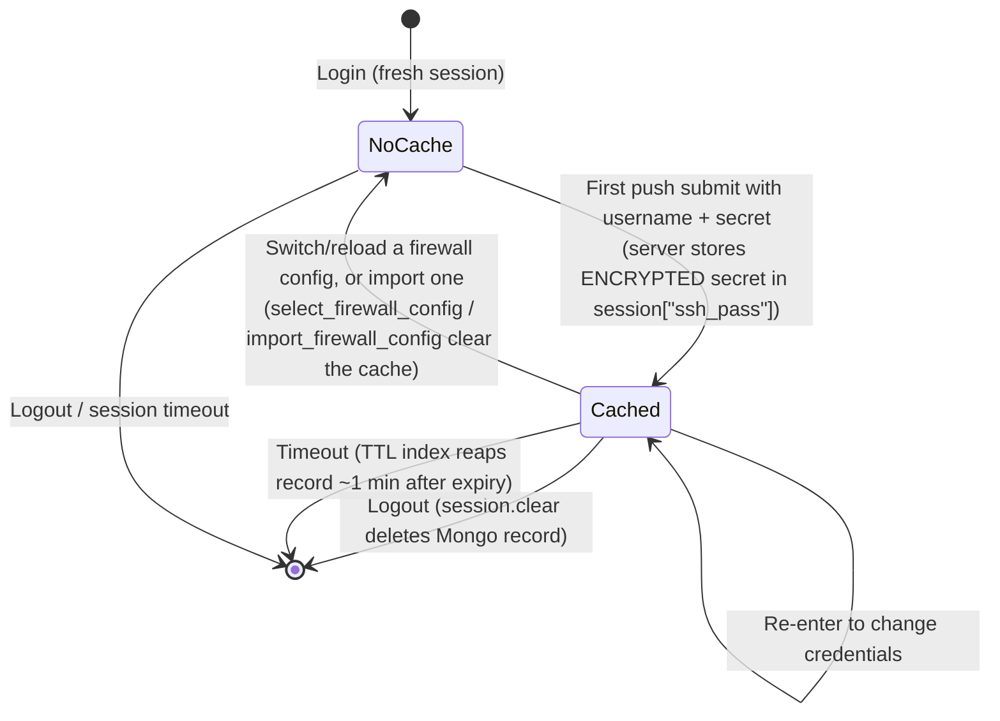
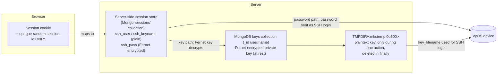

# SSH, Password, Key & Cookie Handling

How FW-GUI connects to VyOS firewall instances over SSH, and exactly how it
stores, uses, and disposes of the credentials involved.

This document is written for two audiences:

- **End users / operators** — the "How it works" and "Lifecycle at a glance"
  sections and the first diagram explain what happens to your password and keys
  in plain terms.
- **Developers / auditors** — every section carries file/function references and
  the remaining sections give the full data-at-rest, logging, and threat detail.

---

## 1. Overview for end users

FW-GUI talks to a VyOS device only when you use the **Configuration Push** page
to *View Diffs*, *Commit*, or *Run an Operational Command*, or **Import from
firewall** on the Configurations page (as of 4.2.2). Every connection first
checks the firewall's SSH host key (pinned on first use) before sending any
credential. Two authentication methods are supported:

| Method | What you enter | What actually authenticates to the device |
|--------|----------------|--------------------------------------------|
| **Password auth** | SSH username + SSH password | The password is sent to the device as the SSH login password. |
| **SSH key auth** | SSH username + the **encryption key** for a previously-uploaded key file | FW-GUI decrypts your stored private key with that encryption key and logs in with the key. The device never receives the encryption key. |

Important detail: **the "Password" field is dual-purpose.** When you select
password auth it is your device password; when you select an uploaded SSH key it
is the *encryption key* (a Fernet key) that unlocks the stored private key. In
both cases FW-GUI treats it as a high-value secret.

For convenience, credentials entered on the **Configuration Push** page are
remembered **on the server** for the rest of your session, so you can run several
actions without re-typing. The secret is never placed in your browser and never
rendered back into the page. The import form uses its credentials for that one
request only and never caches them.

---

## 2. Where the pieces live in code

| Concern | Location |
|---------|----------|
| Push page route (build connection, cache creds, render) | `app.py` → `configuration_push()` |
| Config import route (SSH or paste/upload) | `app.py` → `import_firewall_config()` / `_import_from_device()`; form in `templates/configurations.html` |
| Session backend and cookie settings | `app.py` (Flask-Session setup, `SESSION_COOKIE_*`) |
| Session lifetime | `app.py` (`SESSION_TIMEOUT` → `PERMANENT_SESSION_LIFETIME`, `SESSION_PERMANENT`) |
| Cached-secret encryption helpers | `app.py` → `_session_fernet()` / `encrypt_secret()` / `decrypt_secret()` |
| Logout (clears + deletes session record) | `app.py` → `user_logout()` |
| Paramiko client assembly (all device connections) | `package/napalm_ssh_functions.py` → `assemble_paramiko_driver_string()` (the module name is historical; NAPALM was removed in 4.2.6) |
| View Diffs / Commit | `commit_to_firewall()` / `get_diffs_from_firewall()` → `_run_config_session()`; script, line safety check and output parser in `package/config_session.py` |
| Operational commands | `run_operational_command()`; allow-list in `package/validators.py` → `is_allowed_op_command()` |
| Config import fetch | `fetch_running_config()` |
| TCP reachability check (push page GET) | `test_connection()` |
| Host key pinning | `package/host_key_store.py` → `probe_host_key()`, `verify_host_key()`, `pin_record()`, `clear_pinned_key()`; reset route `app.py` → `configuration_host_key_reset()` |
| Key upload + encryption | `package/data_file_functions.py` → `process_upload()` |
| Key storage (MongoDB `keys` collection) | `package/ssh_key_store.py` → `store_key()` / `get_ciphertext()` |
| Key decryption (temp staging) | `package/ssh_key_store.py` → `decrypt_ssh_key()` |
| List uploaded keys | `package/data_file_functions.py` → `list_user_keys()` (delegates to `ssh_key_store.list_key_names()`) |
| Adoption of pre-3.0.0 key files | `package/ssh_key_store.py` → `migrate_legacy_key_files()` |
| Push form template | `templates/configuration_push.html` |

---

## 3. SSH key upload and encryption

When a user uploads a private key file (must end in `.key`), FW-GUI encrypts it
at rest with a freshly generated **Fernet** symmetric key and hands that key to
the user *once*. The plaintext key is never stored.

Reference: `process_upload()` in `package/data_file_functions.py`.

Key facts for auditors:

- **Encryption:** `cryptography.fernet` (AES-128-CBC + HMAC-SHA256). Symmetric.
- **The generated Fernet key is displayed to the user once** (`flash(..., "key")`
  in `process_upload()`) and is **not** persisted by FW-GUI. Losing it
  means the stored key file cannot be decrypted — the user must re-upload.
- **Storage location (3.0.0+):** the encrypted blob is a document in the MongoDB
  `keys` collection, `_id` = `"<username>/<name>"`, with the ciphertext as BSON
  Binary. Pre-3.0.0 it was `data/<username>/<name>.key`;
  `migrate_legacy_key_files()` adopts those at startup and renames the file to
  `.key.migrated`, retained for downgrade and never deleted — that ciphertext is
  the user's only copy.
- `keys` is a **reserved username** and, unlike `instance`, an *auth-critical* one:
  a username is also a collection name, so an account called `keys` would own
  every other user's key ciphertext. A legacy account of that name aborts startup
  until it is renamed.
- **Key material is in full backups as of 3.0.0.** `mongo_dump()` sweeps every
  collection, so `keys.bson` is in the zip and any S3 upload. This is a deliberate
  change from the previous "`.key` excluded" posture, and it is only defensible
  because the Fernet key is never stored server-side: a leaked archive yields
  ciphertext with no way to decrypt it. The retained `.key.migrated` file *is*
  still excluded, as a redundant second copy of what the dump already carries.
- `# TODO -- validate key is a valid ssh key` — uploaded content is not
  yet validated as a real SSH key.
- **A failed upload leaves the raw file behind.** The raw upload in
  `data/uploads/` is deleted only after the ciphertext is stored; if encryption
  or storage raises, the plaintext key stays there until removed by hand
  (nothing clears `data/uploads/` at startup). See Threats.

---

## 4. Connecting to a firewall (both auth paths)

As of 4.2.6 every device connection is Paramiko through
`assemble_paramiko_driver_string()`: View Diffs, Commit, Run Operational Command
and the config import's fetch. (Before 4.2.6 View Diffs and Commit used NAPALM /
napalm-vyos over netmiko, with a second host-key enforcement path.) For **key
auth**, the stored key is decrypted to a short-lived temp file, used, then
removed in a `finally` block.

### Temporary decrypted-key lifecycle

`decrypt_ssh_key(user, name, fernet_key)` (`package/ssh_key_store.py`):

1. Reads the ciphertext from the `keys` collection. A missing document raises
   `FileNotFoundError`, and one user cannot reach another's key — the lookup is by
   `_id` = `"<user>/<name>"`.
2. `Fernet(fernet_key).decrypt(...)`, where the Fernet key arrives as
   `connection_string["password"]` — on the key-auth path that field carries the
   Fernet key, not a login password. A wrong key raises `InvalidToken`.
3. Writes the **plaintext** private key to a `tempfile.mkstemp()` file — a
   cryptographically-random name with **`0o600` (owner-only)** permissions.
   **No `dir=`**, so it lands in the system temp directory, *not* the mounted data
   volume: as of 3.0.0 `data/` holds no secrets at all. Decryption happens before
   the file is created, so a wrong Fernet key leaves nothing staged.
4. Returns that path; Paramiko uses it as `key_filename`.
5. The caller deletes it in a `finally` block: `_run_config_session()` (View
   Diffs and Commit), `run_operational_command()` and `fetch_running_config()`
   each `os.remove` it.
6. In the Paramiko path the temp file is created before `ssh.connect()`; if
   `connect` fails, `assemble_paramiko_driver_string` removes the temp key
   itself (so it is not left staged when the caller never receives the path).
7. If driver assembly raises before a temp file is created, `tmpfile` is
   `None` and cleanup is correctly skipped.

`data/tmp/` no longer holds key material (only a full backup's zip while it is
being built), but `initialize_data_dir()` still wipes it on every startup. That
is deliberate legacy cleanup: on an install upgrading from a version that
crashed mid-operation, the wipe is what removes a stale plaintext private key
staged there.

### Host key policy

As of 3.1.0 the host key is pinned on first use in the config document and
enforced on the authenticating connection (`host_key_store`): only the pinned
key is loaded and `paramiko.RejectPolicy()` refuses any other, so no credential
is sent to an impostor (GHSA-64wj-4f9q-rwr7). As of 4.2.6 this is the only
enforcement path; the netmiko known_hosts staging went with NAPALM.

### View Diffs / Commit config session (as of 4.2.6)

`commit_to_firewall()` / `get_diffs_from_firewall()` run one vbash script built
by `config_session.build_script()`: `configure`, each line of
`build_merge_config()` in its own `{ ... } >>log 2>&1` group between numbered
markers, `compare`, then `exit discard` (View Diffs) or, for Commit, `commit` and
`save` only when no line matched the error pattern and there are changes (a
failed commit is discarded, never saved). As of 4.2.8 a commit also counts only
if a `compare` afterwards shows nothing left uncommitted, and the session's
working files live in a private `mktemp -d` directory: vyos-configd (root)
reopens the commit's output, which the kernel refuses for another user's file
directly in sticky `/tmp`. VyOS exits 0 even for a rejected
line, so errors are read from the output. The lines include the user's extra
items and are run as shell input, as typing them at the VyOS CLI would be; a
line that could escape its redirection (unbalanced quote, trailing backslash,
unquoted comment or shell operator, brace word) is refused before connecting.

### Config import fetch (as of 4.2.1)

`fetch_running_config()` runs the fixed command `show configuration json` over
the same Paramiko/vbash path. Nothing user-supplied reaches the script. The
config does not exist yet, so there is no pin to check: the route probes the
host key (`probe_host_key`), passes it as `host_key=` to
`assemble_paramiko_driver_string()` (enforced with `RejectPolicy`), and on a
successful import writes it into the new config as `system.host_key`
(`pin_record`). The output is the whole device config, WireGuard private keys
and password hashes included, so it is never logged, and `config_import` keeps
only the `firewall` subtree and interface names/descriptions.

### Operational command execution

`run_operational_command()` wraps the user-supplied `op_command` into a VyOS
`vbash` script and runs it over the Paramiko channel. The command must pass
`validators.is_allowed_op_command` before connecting: the first word must be
`show`, and no shell metacharacters (including quotes, backslash and newlines)
are allowed.

---

## 5. Session, cookie & credential caching lifecycle

FW-GUI uses **server-side sessions** (Flask-Session). The browser cookie holds
only an opaque random **session id** (`secrets.token_urlsafe`; Flask-Session's
`SESSION_USE_SIGNER` is left at its default, off, so the id is not signed); all
session contents — including the cached SSH username and secret — are stored
server-side.

Backend configuration (`app.py`):

- `SESSION_TYPE` (env, default `"mongodb"`) selects the backend. With `mongodb`,
  session documents are stored in the existing MongoDB database in a `sessions`
  collection (`SESSION_MONGODB*`). Tests set `SESSION_TYPE=filesystem` for
  offline runs.
- `SESSION_PERMANENT = True` makes sessions honor
  `PERMANENT_SESSION_LIFETIME`, which is derived from the `SESSION_TIMEOUT` env
  var (minutes, default 120).
- The cookie is `HttpOnly` and `SameSite=Lax`, and `Secure` when
  `SESSION_COOKIE_SECURE=True` (off by default so plain-HTTP installs work).
- `APP_SECRET_KEY` signs the CSRF tokens and derives the key that encrypts the
  cached SSH secret (§10).

### What is cached and when

In `configuration_push()` (POST):

- Credentials are resolved **freshly-typed first, else cached**:
  `username = request.form.get("username") or session.get("ssh_user", "")` and
  the same for `password`. An empty password field therefore means "reuse the
  credential cached this session."
- The resolved values are written back to `session["ssh_user"]` /
  `session["ssh_pass"]`, and `session["ssh_keyname"]` when a key is chosen. The
  password/Fernet key is **encrypted before storage** via `encrypt_secret()` and
  decrypted with `decrypt_secret()` on read, so it is not held in cleartext in
  the session store (see §10). This happens before the action runs, so
  credentials that then fail are cached too (re-enter to replace them).
- **The secret is never rendered back to the browser.** The template receives
  only `ssh_pass_cached` (a boolean) and `ssh_user_name`; the password input has
  no `value=` and is `required` only when nothing is cached
  (`templates/configuration_push.html`).

### When the cache is cleared

- On switching / (re)loading a firewall config, `select_firewall_config()`
  resets `session["ssh_user"] = ""`, `session["ssh_pass"] = ""`,
  `session["ssh_keyname"] = ""`.
- A successful **Import from firewall** selects the new config and blanks the
  cache the same way (`import_firewall_config()`). The import never reads or
  writes the cache itself.
- **Explicit logout** (`user_logout()`) calls `logout_user()`
  then `session.clear()`. Emptying a modified session causes Flask-Session's
  `save_session` to **delete the server-side record** (the Mongo `sessions`
  document) and expire the cookie — so the cached secret is actively removed on
  logout, not merely blanked.
- **Session timeout** (idle past `SESSION_TIMEOUT`) is different: no logout
  request runs, so the document persists until it expires. Flask-Session's
  MongoDB backend writes an `expiration` datetime on every save and creates a
  **TTL index** on that field at startup (Flask-Session's MongoDB interface),
  so MongoDB automatically deletes expired session documents (its TTL monitor
  runs about once per minute). Net effect: explicit logout deletes the row
  immediately; timeout deletes it automatically shortly after expiry via the TTL
  index. Because the cached secret is encrypted (see §10), a document lingering
  briefly before reaping does not expose the cleartext secret.
- Note: logout/timeout does **not** touch the encrypted key in the `keys`
  collection (persists by design) or the system temp directory (decrypted keys are deleted per-action in
  the action `finally` blocks, not at logout).

### Where each secret actually resides

---

## 6. Lifecycle at a glance

| Secret | Created / entered | Stored where | Sent to device? | Destroyed |
|--------|-------------------|--------------|-----------------|-----------|
| Device SSH password | User types on push form | Server-side session (`ssh_pass`), **Fernet-encrypted at rest** | Yes, as SSH login password | On config switch, successful config import, logout, or session timeout |
| Fernet encryption key (for uploaded key) | Generated at upload, shown once | **Not stored** by FW-GUI; user keeps it. Cached in server-side session (`ssh_pass`) **encrypted** after entry, for the session | No | Cache cleared on config switch / config import / logout / timeout |
| Encrypted private key | Encrypted at upload | MongoDB `keys` collection, ciphertext as BSON Binary (3.0.0+; previously `data/<username>/<name>.key`) | No (only its decrypted form is used) | Replaced on re-upload; there is no delete-key feature |
| Decrypted private key (temp) | Per action, by `decrypt_ssh_key()` | System temp dir via `mkstemp` (plaintext, `0o600`) | Used as Paramiko `key_filename` for the SSH login | Removed in the action's `finally` (and on connect failure) |
| Session id | On login | Random opaque id in an `HttpOnly`, `SameSite=Lax` cookie (`Secure` with `SESSION_COOKIE_SECURE=True`) | No | Cookie expiry / logout / timeout |

---

## 7. Logging behavior

- `assemble_paramiko_driver_string()` logs the connection parameters at DEBUG
  with the `password` key **removed**, so the password / Fernet key is not
  written to `data/log/app.log`. Hostname, port, username and key name are.
- `ssh_key_store.decrypt_ssh_key()` logs the temp file *path* (not contents) at
  DEBUG.
- `run_operational_command()` logs the command at INFO and its output at DEBUG;
  a rejected command is logged at WARNING.
- View Diffs / Commit (`_run_config_session()`) logs the action, line count and
  hostname at INFO, and the full session output at DEBUG. That output echoes the
  pushed lines (including extra items) and the device's messages.
- Connection and authentication failures are logged as the exception type or
  message, never with credentials. Import failures are logged as the exception
  type only.
- Host key events: a new pin at INFO with its fingerprint, a mismatch at
  WARNING, a reset at INFO.
- `fetch_running_config()` (config import) never logs its output; it holds the
  device's secrets.
- No route handler logs a whole `request.form`. `configuration_extra_items()`
  logs the submitted extra configuration lines at INFO.

---

## 8. Threats & residual risks

| # | Risk | Status |
|---|------|--------|
| 1 | Secret in **client cookie** (readable) | **Mitigated** — sessions are server-side; the cookie holds only a random opaque id (unsigned; `HttpOnly`, `SameSite=Lax`, `Secure` opt-in). |
| 2 | Secret **echoed into HTML** `value=` | **Mitigated** — the push and import password inputs are never prefilled; the push template gets only a boolean. |
| 3 | Secret in logs | **Mitigated** on the SSH path — password stripped before logging; the import fetch never logs its output. Residual: at DEBUG, operational-command output and config-session output (pushed lines and device messages) go to `app.log`, and extra items are logged at INFO. |
| 4 | Cached secret at rest in the Mongo `sessions` collection | **Mitigated** — the cached secret is Fernet-encrypted before storage (§10). Residual: the derivation key comes from `APP_SECRET_KEY`, so a host/app compromise that exposes that key defeats it; still lock down DB access. |
| 5 | Impersonated firewall (MITM) | **Mitigated** (3.1.0, GHSA-64wj-4f9q-rwr7) — the host key is pinned on first use in `system.host_key` and enforced with `RejectPolicy` on every connection, including the import (via `host_key=`); a changed key is refused before authentication. Residual: trust on first use means the first connection (new config, after a reset, after a hostname/port change, or an import) trusts whatever key is presented — check the fingerprint on the push page. |
| 6 | Arbitrary operational commands | **Mitigated** — `is_allowed_op_command` allows only `show ...` with no shell metacharacters or newlines, checked before connecting. Residual: any `show` command is allowed; `show configuration` returns device secrets to the page and, at DEBUG, to `app.log` (unlike the import fetch, which never logs). |
| 7 | `decrypt_ssh_key()` writes the plaintext key to a temp file | **Mitigated** — `tempfile.mkstemp` (crypto-random name, `0o600` owner-only), in the system temp directory rather than the data volume as of 3.0.0, removed in the `finally` of `_run_config_session()`, `run_operational_command()` and `fetch_running_config()`, and by `assemble_paramiko_driver_string()` if `ssh.connect` fails. Residual: the key is still briefly on disk (Paramiko needs a file path), and a hard process kill between create and `os.remove` could leave it until the OS clears the temp dir. |
| 8 | Uploaded `.key` content is not validated as a real SSH key | **Residual** — see the `# TODO` in `process_upload()`. |
| 9 | Plaintext upload left in `data/uploads/` when key encryption or storage fails | **Residual** — the raw file is removed only on success, and nothing clears `data/uploads/` at startup. |
| 10 | Pushed lines (including the user's extra items) run as vbash shell input | **By design, contained** — the same as typing them at the VyOS CLI with the user's own credentials; a line that could escape its per-line redirection (unbalanced quote, trailing backslash, unquoted comment or shell operator, brace word) is refused before connecting (`config_session.unsafe_reason`). |

---

## 9. Operator notes

- Set a unique `APP_SECRET_KEY` — it signs CSRF tokens **and** derives the key
  that encrypts the cached SSH secret (§10). See the inline comments in `.env` /
  compose files / Helm values.
- With `SESSION_TYPE=mongodb` (default), still restrict MongoDB access. The
  cached SSH secret is encrypted at rest, but everything else in the session
  (username, firewall name) is not, and defense-in-depth matters.
- The Fernet encryption key shown after a key upload is displayed **once** and is
  not recoverable — users must record it to use key auth later.
- Set `SESSION_COOKIE_SECURE=True` when FW-GUI is served over HTTPS.
- After the first connection to a firewall (or an import), check the pinned
  host key fingerprint shown on the push page against the device, and use the
  reset button only for a legitimate key change.

---

## 10. Encryption of the cached secret at rest

The cached SSH secret (device password, or the Fernet key that unlocks an
uploaded private key) is **encrypted before it is written to the session store**
and decrypted only when needed to build a connection. This protects it against
read access to the session backend (e.g. the Mongo `sessions` collection).

### How it works (implemented)

Application-level field encryption in `app.py`:

- `_session_fernet()` builds a `Fernet` from a key **derived from
  `APP_SECRET_KEY`**: `base64.urlsafe_b64encode(sha256(APP_SECRET_KEY))`. The
  encryption key is never stored — it is recomputed from the app secret.
- `encrypt_secret(value)` / `decrypt_secret(token)` wrap the value. Empty stays
  empty; `decrypt_secret` returns `""` on any failure (e.g. after
  `APP_SECRET_KEY` rotation) rather than raising.
- In `configuration_push()`: the secret is stored as
  `session["ssh_pass"] = encrypt_secret(password)` and read back as
  `decrypt_secret(session.get("ssh_pass", ""))`. `ssh_user` and `ssh_keyname`
  remain plaintext (not sensitive).

Consequences:

- The `val` blob of the Mongo session document contains only the **ciphertext**
  of the SSH secret; a database dump does not reveal it.
- Rotating `APP_SECRET_KEY` invalidates cached secrets (they fail to decrypt and
  fall back to `""`, so the user simply re-enters). This is acceptable —
  cached secrets are session-scoped.
- **Threat boundary:** this defends against *DB-at-rest / DB-read* exposure. It
  does **not** defend against a compromise of the app host/process, since the
  derivation key comes from `APP_SECRET_KEY` available there.

### Expiry / reaping

Flask-Session's MongoDB backend creates a **TTL index** on the `expiration`
field at startup, so MongoDB
automatically deletes expired session documents (TTL monitor runs ~once/minute).
No manual index is required.

### Alternatives (not implemented)

If a stronger boundary is later required:

| Option | Protects against | Cost |
|--------|------------------|------|
| Infra: MongoDB Enterprise/Atlas encrypted storage engine | Stolen disk (transparent) | Enterprise/Atlas only; not community `mongo` |
| Infra: volume/disk encryption (LUKS, cloud disk) under Mongo data dir | Stolen disk | Ops-only, no app change; does **not** stop DB-read access |
| App: whole-session encryption via a custom `MongoDBSessionInterface` subclass | DB-read access, for all session fields | Couples to Flask-Session internals |
| App: dedicated `SESSION_ENC_KEY` env var instead of deriving from `APP_SECRET_KEY` | Decouples secret rotation; key not tied to CSRF signing | One more secret to manage |
| MongoDB CSFLE / Queryable Encryption | DB-read access, with KMS-managed keys | Requires KMS + `libmongocrypt`; heavy for session blobs |
